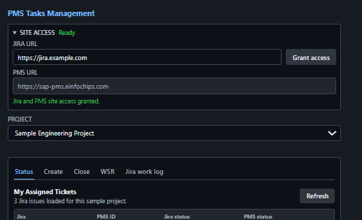
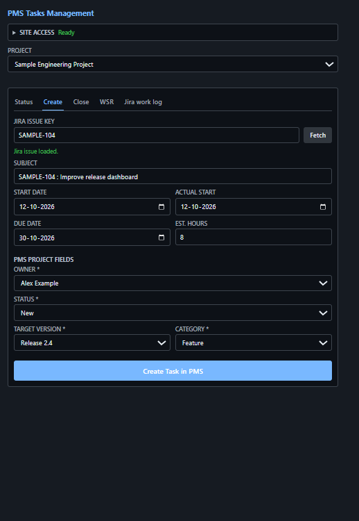
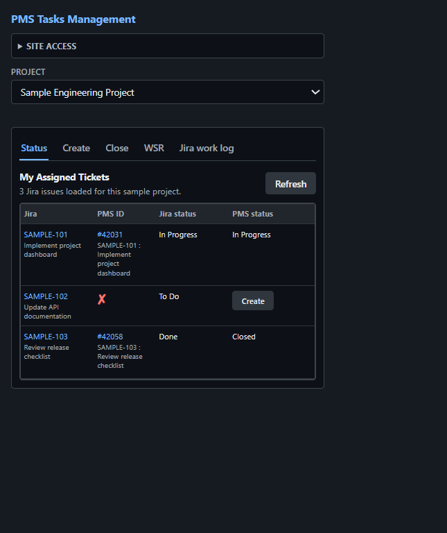
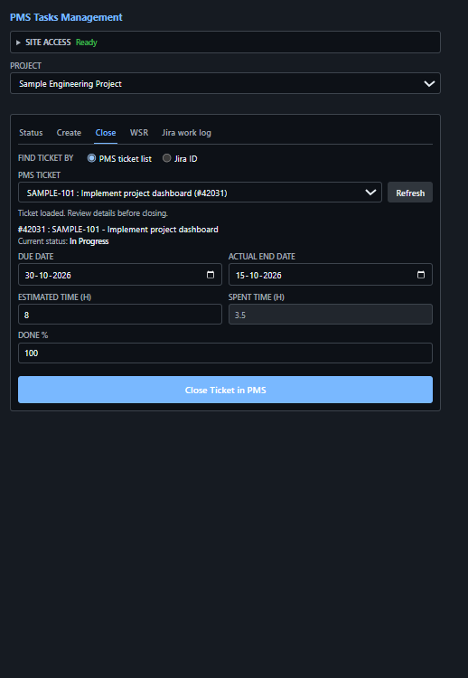
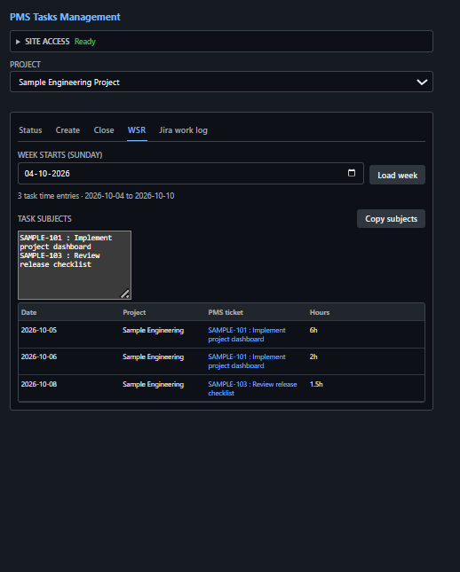
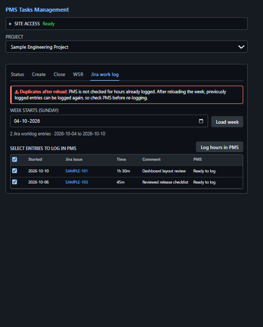

<h1> PMS Tasks Management</h1>

Create PMS tasks from Jira issues using an Edge or Chrome extension.

Screenshots below use illustrative sample data, not live Jira or PMS records.

## &#9881;&#65039; Setup

1. Open `edge://extensions` or `chrome://extensions` and enable **Developer mode**.
2. Choose **Load unpacked** and select this folder.
3. Click the extension icon to open PMSTasksMgmt in the browser side panel.
4. Keep Jira and PMS logged in. Reload the extension after code changes.
5. Enter your Jira URL at the top and click **Grant access**. Tabs stay
  disabled until Jira and PMS site access is granted. The URL is saved for
  next time.
  

## &#9654;&#65039; Use

Choose the **Project** above the tabs. The selection is shared by **Create**,
**Status**, and **Close** and is remembered for next time. Changing projects
reloads its fields and ticket lists and clears any loaded Close ticket.
Connection/loading errors appear below the shared selector.

### Create

1. Open the popup and fetch a Jira issue, or use the automatically detected key.
2. Check the PMS project at the top. **Owner, target version, and category are required.**
3. Check the dates and estimated hours, then click **Create Task in PMS**.

The created task opens automatically. Tracker is fixed to **Development** and
priority uses the project default. Choose a valid initial status for the task;
workflow-required Done % is submitted as `0` automatically.



### Status

Open **Status** to compare your assigned Jira issues with their PMS tickets,
including closed PMS tickets, in the selected project. Jira assignments are
unchanged; a missing PMS match means no match in that project.
Each PMS ticket is shown once per Jira issue, even if the open and closed
searches return overlapping results. Distinct PMS tickets for the same Jira
issue are listed together.
The table shows each ticket's current status and subject. Jira IDs in PMS
subjects link the two; a red cross marks an issue with no matching ticket or a
PMS ticket without a Jira ID. Closed Jira items are hidden unless they have an
open PMS ticket. Use **Refresh**
to reload the list. For a Jira issue with no PMS ticket, click **Create** in the
PMS status column to open the Create tab with that issue's details fetched.



### Close

Choose how to find the ticket under **Find ticket by**:

- **PMS ticket list** (default) lists the open PMS tickets assigned to you
  in the selected project. The list loads at startup; use **Refresh** to reload it.
  Select a ticket to load it.
- **Jira ID**: enter a Jira key and click **Fetch** to load the PMS ticket whose
  subject contains that key in the selected project (none or several matches
  is an error).

The ticket's due date, actual end date (today if empty), estimated time, and
spent time are loaded. Edit the values (spent time is read-only, from
timesheets), keep Done % at 100 or change it, then click **Close Ticket in PMS**.
The ticket is set to the Closed status, its other fields are sent back
unchanged, and it is removed from the list.



### WSR

Open **WSR**, choose the Sunday that starts the week, and click **Load week** to
view your PMS timesheet entries by date, project, ticket, and hours. Weeks
crossing into a new month include entries from both months. The **Task subjects**
list contains each subject once; click **Copy subjects** to copy the list.



### Jira work log

Open **Jira work log**, choose the Sunday that starts the week, and click
**Load week** to view your Jira worklogs for that week, including issue, author,
duration, and comment. The list includes worklogs authored by your signed-in Jira user.

Check entries and click **Log hours in PMS** to add them to your PMS timesheet.
Each entry is logged on its Jira date against the PMS ticket whose subject
contains the Jira key, with the worklog comment as the remark. Entries with no
matching PMS ticket, more than one match, or a PMS error are marked in the
**PMS** column and stay selected for retry. Logged entries can't be logged again
until the week is reloaded, so **check PMS before re-logging after a reload**.



## &#9888;&#65039; Important

- Duplicate checking blocks any issue with the same Jira ID in the selected
  project, even if its title changed. Matching ignores case and uses complete
  IDs, not prefixes. Subjects without a Jira prefix use full-subject matching.
- Status includes open tickets assigned to your PMS user, even when their
  linked Jira issue is assigned to someone else; Jira status is looked up by key.
  PMS matches and Close lookups are limited to the project selected at the top.
- WSR and Jira work log keep their user/week scope; the Project selector does
  not filter these tabs or change their cross-project timesheet ticket lookup.
- Search visibility, indexing delays, and simultaneous submissions can still
  allow duplicates; guaranteed prevention requires server-side enforcement.
- If creation has an uncertain outcome, **check PMS before retrying**.
- PMS validates custom fields. Unsupported workflow requirements block creation.
- Site access for your Jira URL and `https://sap-pms.einfochips.com` can be
  reviewed under the extension's **Site access** settings.
- For troubleshooting, inspect the popup's **DevTools > Network**. Never share
  tokens, cookies, or authorization values.

## &#129514; Tests

Open [popup.html](popup.html) in a regular browser tab, then run in DevTools Console:

```javascript
const script = document.createElement('script');
script.src = 'tests/popup-regression.js';
script.onload = async () => console.log(await runPopupRegressionTests());
document.head.appendChild(script);
```

Tests use mocks and create no real tasks. Expected mock errors may appear;
reload the tab between runs.
